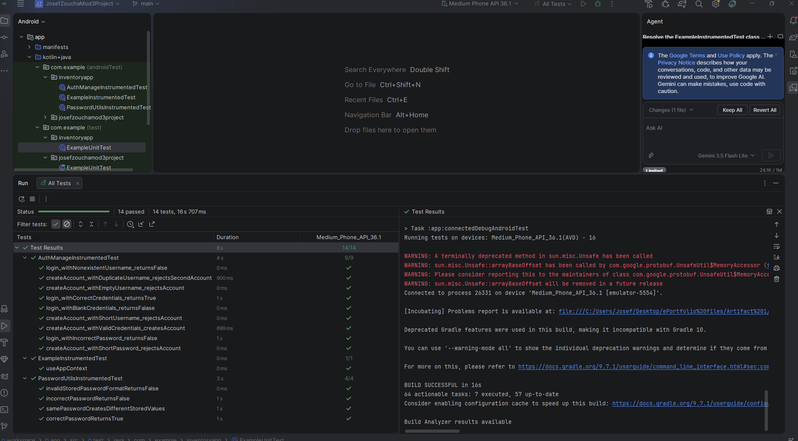

# Artifact One: Software Design and Engineering

[Return to ePortfolio Home](../)

## CS 360 Inventory Management Application

For my Software Design and Engineering artifact, I selected
my CS 360 Inventory Management Application, originally
developed during my CS 360 course at Southern New
Hampshire University.

This Android application was developed using Kotlin and
SQLite. It allows users to create accounts, log in, and
manage inventory records.

## Enhancements Implemented

### Improved Password Security

I replaced the original plain-text password storage with
salted PBKDF2 password hashing. This improvement helps
protect user credentials stored in the SQLite database.

### Improved Software Architecture

I separated authentication, password processing, database
operations, and user interface responsibilities using
LoginActivity, AuthManage, PasswordUtils, and DatabaseHelper.

### Improved Input Validation

I improved input handling by validating account information
and inventory quantities. These changes help prevent errors
caused by blank, nonnumeric, or negative values.

## Testing Results

I performed automated instrumented testing to verify
password hashing, password verification, account creation,
login functionality, and input validation.

All 14 automated tests passed.

## Course Outcomes

This enhancement supports three CS 499 course outcomes:

- **Outcome Three:** Evaluating computing solutions and
  improving existing application design.
- **Outcome Four:** Using appropriate software development
  techniques to create reliable and maintainable solutions.
- **Outcome Five:** Improving application security through
  safer password storage and defensive programming.

## Original and Enhanced Project Files

- [Download Original Application](Artifact1_Original_Source.zip)
- [Download Enhanced Application](Artifact1_Enhanced_Source.zip)
- [Download Full Enhancement Narrative](Artifact1_Narrative.docx)

## Reflection

This enhancement helped me better understand how software
architecture, security, and input validation contribute
to reliable application development.

Revisiting an existing project also helped me learn how to
improve functionality without unnecessarily replacing
components that already work.

---

## Full Enhancement Narrative

### Artifact Description

For my Software Design and Engineering artifact, I selected my CS 360 Inventory Management Application. I originally created this project during my CS 360 course. The application was built in Kotlin for Android and allows users to create an account, log in, and manage inventory items. 

Users can add, view, and delete inventory records, and the application uses SQLite to store account information and inventory data.

I chose this artifact because it combines several areas of software development in one project. It includes user authentication, database interaction, input handling, mobile development, and object-oriented programming. I also felt it was a good artifact to revisit because the original application worked, but there were still areas where the security, structure, and reliability could be improved.

### Justification for Inclusion and Enhancement

I included this artifact in my ePortfolio because it shows my ability to work with an existing application and improve it instead of starting over from scratch. The original project completed its main purpose, but after reviewing the code again, I noticed several areas that could be improved.

One of the biggest changes I made was to the way passwords are stored. In the original version, passwords were saved directly in the SQLite database as plain text. I added a PasswordUtils object that generates a random salt and uses PBKDF2 hashing before the password is stored. During login, the entered password is processed using the stored salt and compared with the saved hash. This means the application no longer stores the user's actual password directly in the database.

I also improved the organization of the application by separating authentication logic from the user interface and database code. I created an AuthManage class that handles account creation, duplicate username checks, login verification, and password processing. This allows LoginActivity to focus more on user interaction while DatabaseHelper remains focused on storing and retrieving information from SQLite. This separation makes the code easier to understand and maintain.

Another improvement I made was input validation. The original inventory screen used toInt() when converting the quantity field. If the user entered invalid text, the application could fail. I changed this to toIntOrNull() and added checks for blank fields, invalid quantities, and negative values. I also added validation during account creation so users cannot create accounts with blank or overly short credentials.

These changes helped improve the security, reliability, and overall structure of the application while keeping the original functionality working as intended.

### Course Outcomes

I believe this enhancement met the course outcomes I originally planned to address in Module One.

Course Outcome Three was addressed because I reviewed the existing application, identified weaknesses, and improved the design while keeping the original functionality intact. I had to evaluate how the original authentication and input handling worked and decide how those areas could be improved without changing the main purpose of the application.

Course Outcome Four was addressed through the software development techniques I used during the enhancement. I separated responsibilities between classes, improved database interaction, added input validation, and used safer programming practices to make the application more reliable and maintainable.

Course Outcome Five was also addressed through the security improvements. The original application stored passwords in plain text, which created a security risk. Replacing that design with salted password hashing reduced the risk of exposing user credentials if the database were accessed.

At this time, I do not have any major changes to my original outcome-coverage plan. Outcomes Three, Four, and Five still match the main skills demonstrated through this enhancement.

### Changes Made Following Instructor Feedback

After reviewing feedback from my initial submission, I focused on making the software architecture portion of the enhancement clearer and I focused on providing stronger evidence that the changes worked as planned. The revised artifact separates the user interface, authentication logic, password handling, and database responsibilities through LoginActivity, AuthManage, PasswordUtils, and DatabaseHelper more clearly.

I expanded the testing of the enhanced authentication system. I created instrumented tests for PasswordUtils and AuthManage to verify password hashing and verification, valid account creation, duplicate username rejection, successful and unsuccessful login attempts, nonexistent accounts and account input validation. All of the automated instrumented tests pass. I also manually tested the inventory validation to confirm that blank fields, nonnumeric quantities and negative quantities are rejected while valid inventory items can still be added successfully.

The revisions strengthened the artifact by showing not only the completed security and design improvements, but also how the application was tested after the enhancement. The additional testing gave me more confidence that the new authentication and validation features work correctly without removing the original functionality of the inventory management application.

### Reflection on the Enhancement Process

Working on this enhancement helped me better understand the difference between making an application work and designing it in a way that is secure, reliable, and easier to maintain. When I originally completed the project, I was mainly focused on getting the required features working. Revisiting the project gave me the chance to look more closely at how the code was structured and where improvements could be made.

One of the main things I learned was the importance of separating responsibilities within an application. In the original version, the login activity communicated more directly with the database for authentication. After the enhancement, the user interface, authentication logic, password handling, and database operations are more clearly separated. This made the code easier to follow and gave each part of the application a clearer purpose.

I also learned more about password security. After adding the hashing system, I used Android Studio's Database Inspector to confirm that passwords were no longer stored as plain text. Instead, the database stored the salt and password hash. Being able to see that change directly helped reinforce the importance of protecting sensitive information.

The input validation changes also helped me understand the importance of defensive programming. The original quantity conversion worked when valid data was entered, but it did not safely handle unexpected input. Using toIntOrNull() and checking the values before sending them to the database made the application more reliable.

One challenge I faced was making sure the new authentication system still worked correctly with the rest of the application. Because the original accounts were created using plain-text passwords, I needed to create new test accounts after adding password hashing. I also retested account creation, duplicate usernames, incorrect passwords, successful login, invalid inventory input, valid inventory items, and item deletion to make sure the application continued to work correctly after the changes.

Overall, this enhancement improved the artifact in several meaningful ways. The application now has stronger password security, better separation of responsibilities, improved input validation, and safer handling of user input. The process also helped me better understand how software design, security, and defensive programming can work together to improve an existing application.
