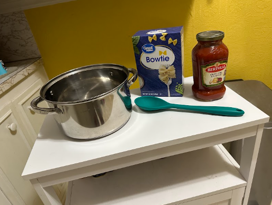
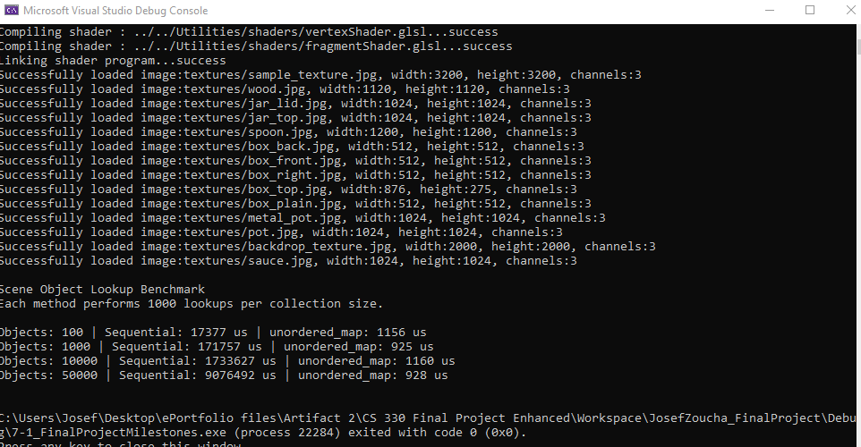

# Artifact Two: Algorithms and Data Structures

[Return to ePortfolio Home](../)

## CS 330 Computational Graphics and Visualization

For my Algorithms and Data Structures artifact, I selected
my CS 330 Computational Graphics and Visualization final
project, originally developed in early 2026.

The application was written in C++ using OpenGL and renders
a 3D kitchen scene featuring a pasta box, sauce jar, metal
pot, spoon, table, and textured background.

## Original Scene Reference

The following reference image was used when creating my
original 3D scene.

## Completed 3D Scene

My application supports perspective and orthographic camera
projections, along with free-camera movement.

### Perspective View

### Orthographic View

### Free-Camera View

## Enhancements Implemented

### Scene Object Data Structure

I created a SceneObject structure to organize the properties
of each object, including its unique ID, transformations,
materials, textures, and mesh information.

### Improved Object Storage and Lookup

I implemented a vector to store scene objects and an
unordered_map to provide efficient lookup using unique IDs.

This replaced the need to search through objects sequentially
when locating a specific scene object.

### Reusable Rendering Functionality

I added reusable methods to manage and render scene objects.
This helped reduce repeated rendering code and improved the
overall organization of the application.

### Object Removal and Lookup Maintenance

I added methods to remove scene objects and rebuild the
lookup table so object IDs remain correctly associated
with their positions in the vector.

## Benchmark Testing

I performed benchmark tests comparing sequential searching
with unordered_map lookups using collections containing
100, 1,000, 10,000, and 50,000 scene objects.

The tests demonstrated that sequential searching required
more time as the collection grew, while hash-based lookup
times remained relatively consistent.

## Course Outcomes

This enhancement supports two CS 499 course outcomes:

- **Outcome Three:** Evaluating algorithmic solutions,
  selecting appropriate data structures, and considering
  performance and memory trade-offs.

- **Outcome Four:** Applying C++, OpenGL, and efficient
  data structures to improve an existing application.

## Original and Enhanced Project Files

- [Download Original Application](Artifact2_Original_Source.zip)
- [Download Enhanced Application](Artifact2_Enhanced_Source.zip)
- [Download Full Enhancement Narrative](Artifact2_Narrative.docx)

## Reflection

This enhancement helped me understand how selecting
appropriate data structures can improve the efficiency
and maintainability of an existing application.

By combining vector-based storage with hash-based lookup,
I improved the organization and accessibility of scene
objects while preserving the original appearance of
the rendered environment.

---

## Full Enhancement Narrative

### Artifact Description

For my Algorithms and Data Structures artifact, I decided to go with my CS Computational Graphics Visualization final project. This project was originally created and designed over January and February of 2026 while I took my CS 330 course. This project was written in C++ using OpenGL and renders a 3D scene containing several objects, including a table, pasta box, sauce jar, metal pot, a spoon, and a backdrop to tie the scene together. The scene uses lighting, textures, materials, transformations, and reusable mesh shapes to create the scene.

I chose this artifact because it gave me an opportunity to improve the organization and accessibility of the scene data. The original project worked as intended, but most of the object information was written inside RenderScene() through repeated transformation, material, texture, and drawing code. This made the project a strong choice for showing how algorithms and data structures can improve an existing application.

### Justification for Inclusion and Enhancement

This artifact was included in my ePortfolio because it demonstrates my ability to work with data structures and improve the way information is stored and accessed inside of a program. The intent of the enhancement was to improve the organization of the scene and the way objects are located and rendered without changing the purpose of the original project.

One of the bigger changes that was made was creating a SceneObject structure. Now, each scene object stores a unique ID along with its scale, rotation, position, material, texture or color, mesh type, and any additional rendering options that are needed. This allows related information for each object to stay together instead of being spread throughout RenderScene with repeated code.

I also added a `vector<SceneObject>` to store the scene objects in an ordered collection. I added an unordered_map along with the vector that connects each object’s unique ID to its index in the vector. I created an AddSceneObject() method that adds each object to the vector and registers its ID in the hash-table. The method also checks for duplicate IDs so an existing object can be updated instead of creating another entry with an identical identifier.

Another important change to the project was the addition of FindSceneObject(). A sequential search through a collection can require checking objects one at a time until the correct one is found, which will have O(n) time complexity in the worst case. The unordered_map allows location of an object using its unique ID with average O(1) lookup time. This requires additional memory to maintain the hash table, but it improves lookup performance as the number of scene objects increases.

I created a reusable method RenderSceneObject() to use the information stored inside each SceneObject to apply the correct transformation, material, texture or color, and mesh before drawing it. I then converted the backdrop, table, pasta box, sauce jar, metal pot and spoon to use this new system.

The larger objects needed to be separated into multiple scene components because they use different textures, meshes, or rendering settings. The pasta box has separate entries for all sides being rendered because each side uses a different texture for example. The sauce jar also required the structure to support solid colors and textures.

These changes improved the internal organization of the project while keeping the appearance and functionality of the original scene intact.

### Course Outcomes

This enhancement does meet the course outcomes I originally planned to address in Module One.

Course Outcome Three says that students should “design and evaluate computing solutions that solve a given problem using algorithmic principles and computer science practices and standards appropriate to its solution, while managing the trade-offs involved in design choices.” This outcome was addressed by my redesign of how scene objects were stored and accessed. I used a vector for ordered object storage and an unordered_map for hash-based lookup by unique ID. This allowed me to compare sequential searching with average O(1) hash-based lookup while also considering the extra memory that will be required to maintain the hash table.

Course Outcome Four states that students should “demonstrate an ability to use well-founded and innovative techniques, skills, and tools in computing practices for the purpose of implementing computer solutions that deliver value and accomplish industry specific goals.” This outcome was addressed through the tools and techniques I used to improve the scene-management system. Using C++, OpenGL, Visual Studio, vectors, reusable structures, hash tables, and helper methods made the code more organized, easier to maintain, and more efficient to work with in the end.

At this point in time, I do not have any major changes to my original course outcome plan. Outcomes Three and Four best represent the skills that were demonstrated through this enhancement.

### Changes Made Following Instructor Feedback

After reviewing my instructor’s feedback, I made several additional improvements to the artifact. One of the main changes was adding a BenchmarkSceneObjectLookup() method so I could measure the performance difference between sequential searching and the unordered_map lookup. The benchmark created temporary collections containing 100, 1,000, 10,000, and 50,000 SceneObject records and performed 1,000 searches on each collection. For the sequential search, I searched for the last object in the vector so the program would have to check the entire collection. The sequential search times increased from 17,377 microseconds with 100 objects to 9,076,492 microseconds with 50,000 objects. In comparison, the unordered_map lookup remained much more consistent, ranging from about 900 to 1,200 microseconds. These results gave me actual performance data that supported the difference between O(n) sequential searching and the average O(1) lookup provided by a hash table.

I also added more detail about the limitations of unordered_map. While hash-based lookup has an average time complexity of O(1), its worst-case performance can become O(n) if a large number of keys result in hash collisions. Including this helped me better explain that there are still trade-offs involved when choosing a data structure, even when it generally provides better lookup performance.

Another improvement I made was adding RebuildSceneObjectLookup() and RemoveSceneObject() to make sure the vector and hash table stay synchronized when an object is removed. Removing an object from a vector can cause the indexes of the remaining objects to change, which would make the indexes stored in the hash table incorrect. RemoveSceneObject() removes the selected object and then uses RebuildSceneObjectLookup() to update the ID-to-index mappings based on the new order of the vector. I tested this by removing a temporary object and confirming that another object whose index had changed could still be located correctly with FindSceneObject(). These changes helped make the artifact more complete by showing not only the performance benefits of the new data structures, but also how they can be maintained correctly as the collection changes.

### Reflection on the Enhancement Process

Working through this enhancement helped me better understand the role data structures have for improving a program that already works. When originally completing the project, I was more focused on building my 3D scene and making sure the objects looked correct. I was able to focus more on how the scene information was being stored and how the design could be improved after revisiting the project.

One of the main things I learned was the difference between sequential searching and hash-based lookup. A sequential search can take longer as the number of objects increases because multiple entries may need to be checked before finding the correct one. Using an unordered_map allows the program to use an object’s unique ID to find it with an average O(1) lookup time. I also learned that there is a trade-off with this improvement at the cost of higher memory usage.

I also learned more about organizing related information into one structure. The SceneObject structure keeps each object’s transformation, material, texture or color, mesh type, and rendering options together. This made the scene data easier to understand and reduced the amount of information that was scattered throughout the rendering code.

One challenge I faced was making the new structure flexible enough to support every object in the scene. The pasta box used different textures on different sides, the sauce jar used both textures and solid colors, the pot contained several smaller pieces, and the spoon used several different mesh types. Due to this, I had to gradually expand the SceneObject structure so it could support each type of object without changing how the original scene looked.

Another challenge I faced was making sure the enhancement didn’t accidentally change the appearance of the scene. I handled this by making the changes one object at a time and building the solution and checking the final render of the scene before moving on to the next object. This made the process easier to test and helped me catch smaller problems before they affected other areas of the project.

Overall, this enhancement improved the artifact by giving the scene a more organized data structure, reducing repeated rendering code, and adding a faster method for locating scene objects. It also helped me better understand how data structures, algorithmic choices, and design tradeoffs can improve the efficiency and maintainability of an existing program.
