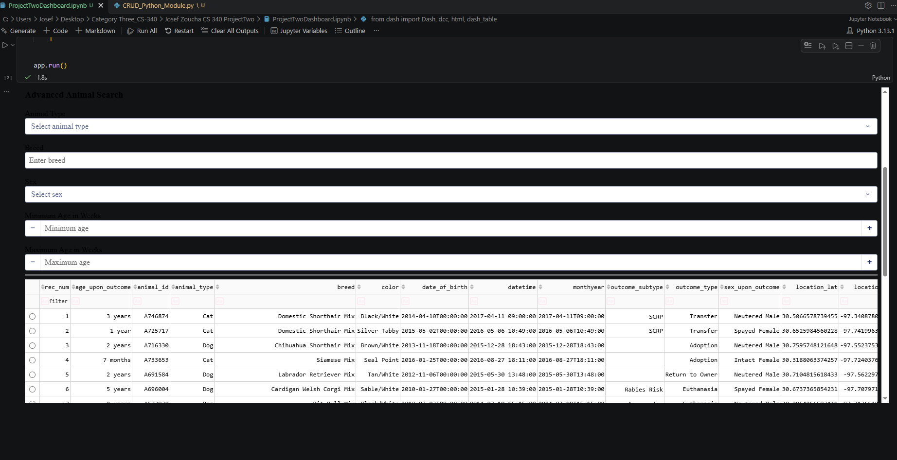
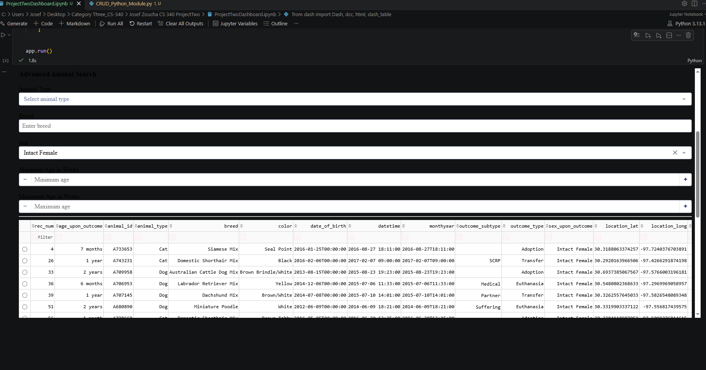
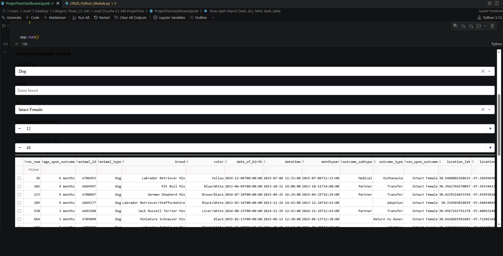

# Artifact Three: Databases

[Return to ePortfolio Home](../)

## CS 340 Animal Shelter Dashboard

For my Databases artifact, I selected my CS 340 Animal
Shelter Dashboard, originally developed during my
Computer Science program at Southern New Hampshire
University.

The application uses Python, MongoDB, and the Dash
framework to allow users to search, filter, and view
animal shelter records through an interactive dashboard.

## Enhancements Implemented

### Dynamic MongoDB Queries

I improved the original filtering system by allowing
users to search for animals using different combinations
of criteria, including animal type, breed, sex, age
range, and rescue category.

### Database Indexing

I created MongoDB indexes on four commonly searched
fields: animal_type, breed, sex_upon_outcome, and
age_upon_outcome_in_weeks.

These indexes help MongoDB locate matching records
more efficiently during certain searches.

### Improved Search Reliability

I improved the dashboard's handling of searches that
return no matching records. The application can now
return an empty result without causing an error.

## Dashboard Screenshots

### Dashboard Without Filters

This screenshot shows the dashboard displaying animal
records without additional search restrictions.



### Dashboard With One Filter

This screenshot demonstrates filtering animal records
using a single search criterion.



### Dashboard With Multiple Filters

This screenshot demonstrates how multiple user-selected
criteria can be combined to narrow the search results.



## Database Performance Testing

I used MongoDB's explain() functionality to compare
a normal indexed query with a forced collection scan.

The indexed query examined 608 documents, while the
collection scan examined 10,000 documents to return
the same six records.

This represented a 93.92% reduction in documents examined.

The indexed query took 10 milliseconds compared with
6 milliseconds for the collection scan, showing that
reduced document scanning does not always result in
faster execution time.

I also tested conflicting search criteria and confirmed
that the application correctly returned an empty list
when no animals matched the selected filters.

## Course Outcomes

This enhancement supports two CS 499 course outcomes:

- **Outcome Three:** Evaluating database query strategies,
  performance trade-offs, and computing solutions.

- **Outcome Four:** Applying Python, MongoDB, CRUD
  operations, indexing, and the Dash framework to
  improve an existing application.

## Original and Enhanced Project Files

- [Download Original Application](Artifact3_Original_Source.zip)
- [Download Enhanced Application](Artifact3_Enhanced_Source.zip)
- [Download Full Enhancement Narrative](Artifact3_Narrative.docx)

## Reflection

This enhancement helped me better understand the
importance of database efficiency, dynamic query
construction, and reliable application behavior.

By improving how the dashboard retrieves and filters
animal records, I gained more experience with MongoDB
and learned how database changes can affect the
functionality of an entire application.


---

## Full Enhancement Narrative

### Artifact Description

For the databases section of my ePortfolio, I selected my animal shelter dashboard I originally created during my CS 340 course. The project was developed using MongoDB, Python and the Dash framework. The purpose of the dashboard is to allow users to view and filter records stored within a MongoDB database through an interactive dashboard.

The original application included a Python CRUD module that connected the application to MongoDB, and allowed information to be retrieved from the database. The dashboard displayed this information through an interactive data table, a graph, and a geographical map. It also included predefined filters that allowed users to search for animals that met specific rescue criteria.

I selected this project because it demonstrates my ability to combine database management with application development. It shows how data can be stored, retrieved, filtered, and presented to users through a functional software interface.

### Justification for Inclusion and Enhancement

This artifact was chosen because it demonstrates several skills that are important to database development and software engineering. This application requires Python, MongoDB, CRUD operations, database queries, and user interface components that all work together as one system.

A limitation from the original project was the filtering functionality. Much of the filtering functionality depended on predefined queries which worked for the original assignment, but it limited the user’s ability to search the database with different search parameters.

For the artifact’s enhancement, I improved the database functionality by adding flexibility to the filtering system. Instead of relying on predetermined searches, the application can create MongoDB queries based on the criteria selected by the user. These criteria can include information such as animal type, breed, sex, age range, and rescue category.

Database performance was also improved by adding indexes to fields that are frequently searched. Indexing allows MongoDB to locate matching records more efficiently instead of examining every document in the collection during certain searches. This allowed me to think about database performance in addition to just retrieving the correct information.

The original functionality of the dashboard was maintained while the database interactions were improved. The table, graph, and map still display the animal records, but the information shown is based on the improved filtering system. I also improved the way the application handles situations in which a search does not return any matching records. Instead of leaving the dashboard in an unclear state, the application can respond more appropriately when no results are available.

The improvements made demonstrate my ability to evaluate an existing application, identify limitations, and make meaningful changes without unnecessarily replacing functionality that already works. The enhanced artifact demonstrates skills in MongoDB, Python, CRUD operations, query construction, database integrations, indexing, and software development.

### Course Outcomes

The primary course outcomes I planned to address through this artifact enhancement were Outcomes Three and Four.

Outcome Three focuses on designing and evaluating computing solutions using algorithmic principles and computer science practices while considering the trade-offs involved in design decisions. This enhancement supports that outcome because I evaluated the original filtering system and determined how database queries could be constructed more effectively. Creating queries from different combinations of user-selected parameters required me to consider how the application would process those selections and convert them into valid MongoDB queries.

Adding in indexes also relates to Outcome Three because database design involves trade-offs. Indexes can improve the speed of searches; however, they can require additional storage and database maintenance. Considering both the advantages and disadvantages helped me better understand that computing solutions should be evaluated based on more than whether or not they just work.

Outcome Four focuses on using appropriate techniques, skills, and tools to create computing solutions that provide value and accomplish specific goals. This enhancement strongly supports that outcome through my use of Python, MongoDB, CRUD operations, database queries, and the Dash framework to make the application more flexible and efficient.

I don’t have any major changes to my original outcome-coverage plan. Outcomes Three and Four are the ones most clearly demonstrated through this enhancement. The enhanced version of the artifact provides stronger evidence of these outcomes because it shows my ability to evaluate an existing solution and improve its database functionality rather than simply creating a connection that works.


### Changes Made After Instructor Feedback

After reviewing my feedback for this enhancement, I went back through my project to provide more detailed evidence of the improvements to the database. My instructor recommended that I explain the fields that were indexed, show how the indexes affected database performance, and include examples of the dynamic queries and testing results.

The first thing I addressed was explaining the indexes I added to MongoDB. Four fields were added as indexes, animal_type, breed, sex_upon_outcome, and age_upon_outcome_in_weeks. These fields were chosen because they are commonly used when searching for animals in the dashboard. Adding these indexes gives a more efficient way to locate matching records to MongoDB instead of having to search through the entire collection each time.

I also wanted to see what kind of difference the changes made. I used MongoDB’s explain() functionality to test this. Using explain(), I compared a normal query that used an index with a query that was forced to scan the entire collection. The indexed query returned 6 matching animals from examining 608 documents, while the collection scan examined 10,000 documents to find the same 6 animals. This proved a 93.92% reduction in the number of documents examined. However, the indexed query took 10 milliseconds to execute as opposed to the collection scan that took 6 milliseconds. Though the indexed query was not faster during this test, it shows that indexes reduced the amount of documents MongoDB needed to examine, this helped me understand that even if fewer documents are scanned, it will not always yield a faster execution time.

Another area I focused on was providing an example of how the improved filtering system works. I tested the Water Rescue category along with some additional filters for dogs, Labrador Retriever Mix Breed, and an age range from 52 to 104 weeks. The dashboard combined the Water Rescue requirements with the additional search parameters using MongoDB’s $and operator. The search returned six matching animals meeting the filtering requirements for Water Rescue, breed, sex, and age which confirmed that the application was able to combine different search conditions and retrieve the required records.

I also tested what would happen if someone selected filters that could not produce any results. I selected Water Rescue (which requires dogs), and cats through the advanced filter options. The query could not meet both requirements, so it returned zero query records. The dashboard handled this correctly by returning an empty list without producing an error which shows the enhanced filtering system could handle conflicting search criteria without causing problems in the application.

Throughout the enhancement and after conducting additional tests I was better able to understand the importance of testing and evaluating database functionality. Initially I was more focused on making sure the database returned the correct information. After looking at the actual query statistics, I was able to see how indexing affected the amount of work MongoDB performed and why it is important to consider more than just execution time. Addressing the feedback for this enhancement also gave me more experience with MongoDB queries, testing, and indexing, which helped me provide stronger evidence of the improvements I made to the original dashboard application.


### Dynamically Generated MongoDB Query for Water Rescue and Advanced Search Filters Example

```
{
  "$and": [
    {
      "animal_type": "Dog",
      "breed": {
        "$in": [
          "Labrador Retriever Mix",
          "Chesapeake Bay Retriever",
          "Newfoundland"
        ]
      },
      "sex_upon_outcome": "Intact Female",
      "age_upon_outcome_in_weeks": {
        "$gte": 26,
        "$lte": 156
      }
    },
    {
      "animal_type": "Dog",
      "breed": "Labrador Retriever Mix",
      "age_upon_outcome_in_weeks": {
        "$gte": 52,
        "$lte": 104
      }
    }
  ]
}
```

The example above shows the query generated when I combined the Water Rescue category with the additional animal search filters. The $and operator ensures the records meet both the rescue requirements and the selected search requirements. The $in operator allows MongoDB to check for multiple eligible breeds, while $gte and $lte define the minimum and maximum ages. This query returned 6 animals during testing.

### Reflection on the Enhancement Process

During this project’s enhancement process, I was able to better understand the difference between creating a database application that works and creating one that is flexible, efficient, and maintainable. In the original project, many of the database operations were designed specifically around the requirements of the assignment. Revisiting the project gave me the opportunity to look at the application from a broader software development perspective and consider how it could be improved beyond the original requirements.

One of the biggest things I learned from this enhancement was how much the database affects the rest of the application. The dashboard depends on the information returned from MongoDB, so changing the way queries worked also changed what appeared in the table, chart, and map. This helped me see that database changes cannot really be treated as separate from the rest of the program because each part of the application depends on the others.

I also learned more about database efficiency through the use of indexes. In the original project, my main concern was making sure the correct records were returned. During this enhancement, I started thinking more about how quickly and efficiently the database could find those records. This gave me a better understanding of how database design can affect the overall performance of an application.

One of the more difficult parts of the enhancement was improving the filtering system so that it could handle different combinations of user selections. The original filters were easier to manage because each one used a predefined query. With the updated system, the application had to build a query based on whichever criteria the user selected. I had to be careful with how the query was created and test different combinations to make sure the results were accurate.

I also had to make sure the dashboard still behaved correctly when a search returned very few records or no records at all. This made me think more about situations that may not happen during normal testing but can still affect the user experience. Improving how the application handled these cases made the dashboard feel more reliable and complete.

Overall, this enhancement gave me a chance to improve a project I had created earlier in the Computer Science program instead of starting over from the beginning. I was able to look at the original version, identify areas that could be improved, and make changes that made the application more flexible and efficient. The process helped strengthen my understanding of MongoDB, database queries, indexing, and how the database works together with the rest of an application.
